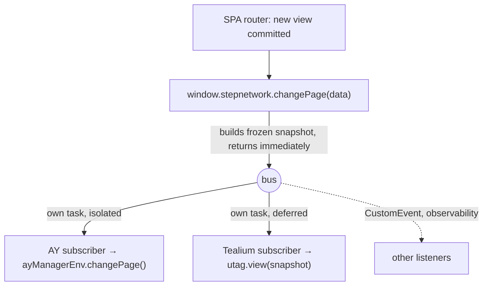

# Overview

## The model

- The **publisher** owns *when* a page changed. They are the only party that knows the new view has rendered.
- The **stub** owns *delivery*: snapshot, sequence number, isolation, late-subscriber replay.
- Each **subscriber** owns *what happens*. AY proxies into `ayManagerEnv.changePage()`. Tealium proxies into `utag.view()` and its own event system.

## What changes versus today

| | Today | With the bus |
|---|---|---|
| Who detects navigation | Tealium profile shim and AY wrapper, independently | Publisher calls one function |
| Per-domain logic | Hostname branches in `utag.js` | None; the call is the signal |
| Ordering between systems | Undefined race | Defined: AY leg first, Tealium leg deferred |
| Page data for AY | Read from `utag.data` (may be previous hop) | Read from snapshot |
| Failure isolation | A throw in one listener can affect the chain | Each subscriber isolated |

## What does not change

- Cold load. Each system bootstraps exactly as today; Tealium still loads the CMP.
- AY SPA mode stays **Reset**.
- Tealium enrichment (Neuwo, Digiseg, consent labels) stays in the profile.
